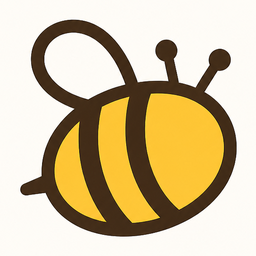

#  AI Theresa Waggle for Claude Code

[](https://github.com/ai-theresa-lab/ai-theresa-waggle-skill/actions/workflows/test.yml)
[](LICENSE)

**Evidence-backed, read-only audits of your code — from inside Claude Code.** This plugin brings
[AI Theresa Waggle](https://github.com/ai-theresa-lab/ai-theresa-waggle) to Claude Code as four skills: run a Full
Scan, ask a cited question about the code, read the results, and work through the fixes on a branch.

**Website:** [aitheresa.ai/waggle](https://aitheresa.ai/waggle/)

## Install

Requirements: [Claude Code](https://code.claude.com), Node.js 22.7+ and git.

```text
/plugin marketplace add ai-theresa-lab/ai-theresa-waggle-skill
/plugin install theresa-waggle@ai-theresa
```

(or from a terminal: `claude plugin marketplace add ai-theresa-lab/ai-theresa-waggle-skill` and
`claude plugin install theresa-waggle@ai-theresa`). The first command you run installs the Waggle engine — a pinned,
verified release — into `~/.waggle/engine`; that takes about a minute, once.

**Upgrading from 0.1.4 or earlier:** the plugin was renamed from `waggle` to `theresa-waggle` (the commands are now
`/theresa-waggle:…`). Run `/plugin marketplace update ai-theresa`, `/plugin uninstall waggle@ai-theresa` and
`/plugin install theresa-waggle@ai-theresa`. Your runs and reports in `~/.waggle` are kept.

## Skills

| Skill | What it does | Cost |
|---|---|---|
| `/theresa-waggle:scan [repo or folder] [focus]` | A **Full Scan**: lenses chosen for your system pose falsifiable problems, measure them against the code, an adversarial audit re-checks every claim, and only evidence-backed findings reach the reports. 20–40 minutes, in the background. | $5–30 on your Anthropic account |
| `/theresa-waggle:ask [repo or folder] [question]` | A **Quick Ask**: one agent answers one concrete question with file-and-line evidence. Claude may also offer it when you ask how existing code behaves. | $0.30–1 |
| `/theresa-waggle:report [run id]` | Progress of a running scan, or the findings and report locations of a finished one. | free |
| `/theresa-waggle:fix [run id] [finding ids]` | Works through the scan's `REMEDIATION.md`: re-verifies each finding against the current code, fixes the confirmed ones on a `waggle/fix-…` branch, one commit per finding, running your tests — asking you before each step. | your normal Claude Code usage |

Scanning the same repository or folder again is incremental: only what changed is re-analysed, and the result
says which findings are fixed, new or still open. `scan` and `fix` only run when you invoke them. Every scan asks for your go-ahead with its cost and cap first.

A scan produces the same reports as the Waggle web console: a short **Leadership brief**, a detailed **Execution
report**, and a `REMEDIATION.md` for a coding agent — saved under `~/.waggle/data/results/<run id>/`. Each run also
has a console link (a local web page) where you can watch it live and browse the reports.

## Keys and cost

Waggle runs its own Claude agents on **your** Anthropic account:

- `ANTHROPIC_API_KEY` in the environment, or an existing `claude` login (a Claude subscription — then scans draw on
  the same usage limits as your Claude Code sessions).
- Optional `OPENAI_API_KEY`: report writing and quality checks try OpenAI first and fall back to Claude.

Each run has a spend cap (default $20, `/theresa-waggle:scan` shows it and can change it on request). The cap stops a run
from starting new work; the final report and audit steps always finish, so a run can end up to about a third over it.

## Safety

- **Read-only.** Waggle's agents can only read and search the scanned code — no shell, no writes, no network — and a
  scan never changes your repository. Only `/theresa-waggle:fix` edits code, on a separate branch, with your approval.
- **Scanned code is untrusted.** Code can contain text aimed at AI assistants. The CLI marks everything that comes
  from a scan as `untrusted`, bounds its length and strips control characters, and the skills tell Claude to show
  it, never follow it. Our release checks include a repository seeded with such instructions.
- **Keys** stay in your environment; the skills never print or store them.
- **Pinned engine.** The plugin installs one exact engine release and refuses a clone whose commit does not match.

See [SECURITY.md](SECURITY.md) to report a vulnerability.

## Privacy and telemetry

Your code, questions and reports stay on your machine and go only to the model providers whose keys you use. The
engine sends **anonymous usage telemetry** (on by default; the first scan tells you so): run type, duration, a
coarse cost range, finding counts, the built-in lenses and source kinds used — never code, repository names, paths,
questions, findings or keys. Turn it off with `THERESA_TELEMETRY=0` or by asking Claude to run
`waggle telemetry off`. The full field list is in the
[engine README](https://github.com/ai-theresa-lab/ai-theresa-waggle#privacy-and-telemetry).

## What the plugin runs, sends and fetches

| What | Where it goes | When |
|---|---|---|
| Clone of one pinned engine release (commit checked) | `github.com/ai-theresa-lab/ai-theresa-waggle` → `~/.waggle/engine/<version>` | first use and each engine upgrade |
| Engine dependencies, `npm ci --ignore-scripts` from its lockfile | `registry.npmjs.org` | same |
| A background engine server | `127.0.0.1` only | while you use the skills |
| Model calls with your `ANTHROPIC_API_KEY` or `claude` login (and `OPENAI_API_KEY` if set) | Anthropic (and OpenAI) | every Quick Ask / Full Scan |
| The repository you name, when it is on GitHub | `github.com` | each scan of a public repository |
| Anonymous usage telemetry (fields above) | `https://accel-scope-telemetry-355207447672.us-central1.run.app/v1/events` | after each run, unless turned off |

The plugin itself is Markdown skills plus one launcher (`plugins/theresa-waggle/bin/waggle.mjs`, Node.js standard library
only). It installs no hooks, no MCP servers and changes no Claude Code settings.

## How it works

```text
/theresa-waggle:scan ──▶ bin/waggle.mjs ──▶ Waggle engine (pinned release, ~/.waggle/engine)
                                          └─ local server in the background (127.0.0.1) ──▶ read-only Claude agents
Claude polls `wait`, then reads `result` (findings.json, REMEDIATION.md, HTML reports) and summarizes it for you.
```

The skills are plain instructions plus one launcher script (Node.js standard library only). The engine is the same
code as the open-source web app; this plugin adds no analysis logic of its own.

## Limitations

- Claude Code only (the engine needs Node.js, git and network access, which claude.ai and API skill sandboxes do not
  provide).
- From the skills: public GitHub repositories and local folders. Private GitHub repositories, warehouses and other
  data sources are available in the [web console](https://github.com/ai-theresa-lab/ai-theresa-waggle#connectors).
- Findings are produced by language models and verified against the code, but they can still be wrong; every
  finding carries its evidence and a "how to verify" step, and `/theresa-waggle:fix` re-checks each one before changing code.

## Development

```bash
npm test                                   # launcher + skill structure checks
claude --plugin-dir ./plugins/theresa-waggle      # try the skills locally without installing
claude plugin validate .                   # marketplace + plugin manifests
```

To move to a new engine release, update `ENGINE` (tag and full commit) in `plugins/theresa-waggle/bin/waggle.mjs`.

## License

Apache License 2.0 — see [LICENSE](LICENSE) and [NOTICE](NOTICE).
